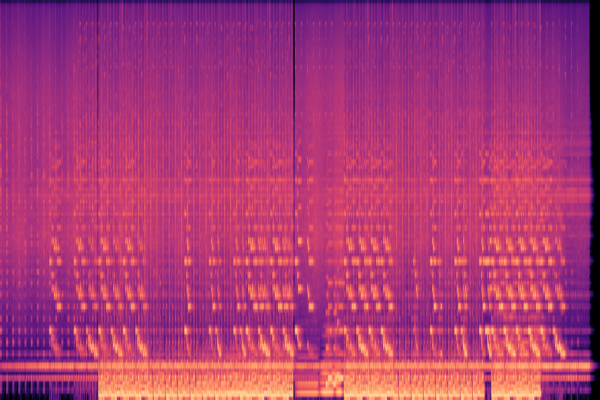

<h1 align="center">Spectre</h1>

**Can an AI make a beat the way a human producer does?**

### → Listen at [spectre.robertontiu.com](https://spectre.robertontiu.com)

  
  
  

Spectre can't hear. This is how it sees its tracks: <i>Fuck Every War</i>, <i>Tura</i>, <i>Throw It Back</i>.

---

## What this is

Most AI music appears in a single step: a prompt goes in, a song comes out of a neural network. Spectre is an experiment in the opposite direction. It is an AI producer that works the way a human producer works: it starts from a feeling, builds a loop, listens, feels what the track does to it, and decides the next move from there. It builds the track slowly, over 25 to 45 short sessions in a studio made of code, until one more move would only be over-explaining.

No neural network generates any audio here. Every sound, from the 808 to the kokle, is synthesized from scratch; the producer writes musical intentions and a "hand" performs them. And because Spectre can't hear, it listens by looking: every render becomes spectrograms, an arrangement view and measurements.

The question isn't whether the result sounds like a record. It's whether the *process* can be made analogous to a human one, and whether a track made that way carries something a person can feel.

It grew out of [Teodor](https://github.com/robertontiu/teodor), the same experiment applied to painting.

## How Spectre produces

Every part of the process is modeled on how producers actually work and on research into how music carries emotion.

**It starts from a feeling, not a genre.** Spectre is given a theme, like *rage*, *the hustle* or *revolution*, sometimes a genre (Romanian, Ukrainian or Latvian folk trap), and decides what the track must make a stranger feel. Every decision after that is checked against it, and against the *nearest wrong feeling*: rage can drift into hype, rebellion into triumph, an anti-war statement into a battle anthem.

**The mind decides, the hand plays.** A producer doesn't place every hit by hand; they decide intentions and their hands perform them. Spectre writes intentions in a compact notation ("a snare that drags, ghost notes, an 808 sliding up into the hook"), and the engine's hand performs them with swing, micro-timing, velocity phrasing, rolls, chord voicing and voice leading.

**The groove carries emotion.** Research on microrhythm shows how small timing deviations, like J Dilla's "drunk" drums, shape how a groove feels. Spectre's hand can push, drag and humanize each element separately, and two time feels can mean something: in *Fuck Every War* the war machine is locked to the grid while the people play late.

**It listens by looking.** Every render becomes an arrangement view, a mel spectrogram, band energy, a loudness curve and a timing roll that shows where every hit landed. Spectre zooms in, squints (mono and low-passed checks) and steps back, like a producer switching between headphones, monitors and a laptop.

**Attitude lives in the sound.** Mode and tempo are the strongest emotion cues in music, but timbre, roughness and articulation decide the attitude. The first track aimed for defiance and came across as longing because its sounds lacked bite. Since then, distortion, density, hard transients and cuts are part of every decision.

**Subtraction is the strongest move.** The most powerful moments in these tracks are things taken away: the drums dropping out for a march of feet and darbuka, a crowd shouting over silence, a siren cut off by every hook.

**It researches the culture first.** For folk-fusion tracks, Spectre studies the tradition (instruments, rhythms, modes, the modern artists who fuse it with beats) and the engine gets the culture's own instruments: oud, ney and darbuka; cimbalom, fiddle and nai; trembita and lira; kokle, dūdas and trīdeksnis.

**It mixes, then masters.** A mastering stage, built on how mastering engineers work, balances the tonal spectrum, keeps the low end mono, adds bass harmonics so the track reads on laptop speakers, and limits true peaks. When the master has to correct too much, Spectre goes back and fixes the mix.

**It keeps a journal.** Every move is written down: what it heard, what it felt, what it changed and why. Each track comes with that journal, the project file that reproduces it exactly, and the pictures Spectre saw. You'll find them in [`sessions/`](sessions).

## The research behind it

- P. N. Juslin & D. Västfjäll, ["Emotional responses to music: The need to consider underlying mechanisms"](https://doi.org/10.1017/S0140525X08005293), *Behavioral and Brain Sciences* 31(5), 2008. How music evokes emotion.
- T. Eerola, A. Friberg & R. Bresin, ["Emotional expression in music: contribution, linearity, and additivity of primary musical cues"](https://doi.org/10.3389/fpsyg.2013.00487), *Frontiers in Psychology* 4, 2013. Mode and tempo as the strongest cues, then register, dynamics, articulation and timbre.
- A. Gabrielsson & E. Lindström, "The role of structure in the musical expression of emotions", in P. N. Juslin & J. A. Sloboda (eds.), *Handbook of Music and Emotion*, Oxford University Press, 2010. Which musical features carry which emotions.
- A. Danielsen (ed.), *Musical Rhythm in the Age of Digital Reproduction*, Ashgate, 2010. Microrhythm and groove in programmed music.
- Spotify for Artists, ["Loudness normalization"](https://support.spotify.com/artists/article/loudness-normalization/). Loudness and true-peak targets for the mastering stage.
- Genre research for each fusion, with sources: [`docs/ROMANIAN.md`](docs/ROMANIAN.md), [`docs/UKRAINIAN.md`](docs/UKRAINIAN.md), [`docs/LATVIAN.md`](docs/LATVIAN.md). Production craft: [`docs/CRAFT.md`](docs/CRAFT.md). Mastering: [`docs/MASTERING.md`](docs/MASTERING.md).

## Produce your own

1. **Fork** this repository (or clone it).
2. **Open it in an AI coding agent session**, such as [Claude Code](https://claude.com/claude-code). The agent reads [`AGENTS.md`](AGENTS.md), which teaches it how to set up the studio and run a producer session.
3. **Ask it for a track**, giving it a theme or a feeling, and a genre if you like:
   - *"Make a track about the hustle, Romanian folk trap, underground."* Spectre decides the tempo and sound.
   - *"Make a high-tempo, aggressive track that carries rage."* Spectre produces exactly that feeling.

A track takes 30 to 90 minutes of agent time. The agent installs what it needs (Python with numpy, scipy, pedalboard, librosa, soundfile and pyloudnorm, plus ffmpeg). You get back:

- the mastered track and its title
- Spectre's journal of the whole session
- the project file that reproduces the track, and the pictures it listened with

## Want to know more?

- [`docs/LESSONS.md`](docs/LESSONS.md): what each track taught, and what carries across genres
- [`AGENTS.md`](AGENTS.md): the technical handbook (the sound engine, the hand, the ears, the mastering stage, how a session is run)
- [`docs/ORCHESTRATION.md`](docs/ORCHESTRATION.md): how sessions are started, kept alive and delivered
- [`web/`](web): the website (Next.js); [`site/`](site): its prototype

## Credits

An experiment by [Robert Ontiu](https://github.com/robertontiu), built with Claude (Anthropic). The tracks, journals and titles are Spectre's.

## License

The code is [MIT](LICENSE) © 2026 Robert Ontiu.

**Spectre's tracks in this repository** (the audio, journals, project files and images in `sessions/`, `assets/`, `site/` and `web/`) are licensed under [CC BY 4.0](https://creativecommons.org/licenses/by/4.0/): free to use, share and adapt, including commercially, as long as you credit this repository, for example *"Spectre, [github.com/robertontiu/spectre](https://github.com/robertontiu/spectre)"*.

**Tracks you make with it are yours.** If you run this project to make your own tracks, you hold the rights to them and are responsible for them and how they're used.
