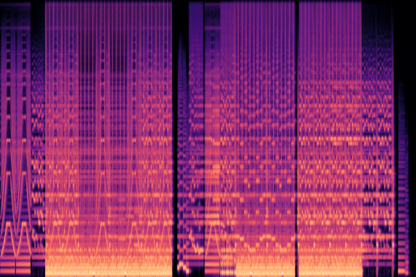
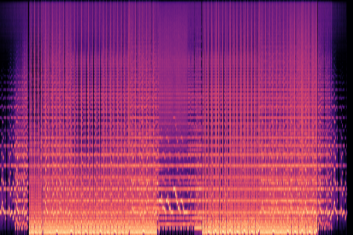

<h1 align="center">Spectre</h1>

**Can an AI make music the way a human producer does: starting from a feeling, researching the genre, and listening and deciding one move at a time?**

### → Listen at [spectre.robertontiu.com](https://spectre.robertontiu.com)

  
  
  

Spectre can't hear. This is how it sees its tracks: <i>Līdz rītam</i>, <i>Fuck Every War</i>, <i>Tura</i>.

---

## What this is

An experiment in engineering creativity. Spectre is an AI producer (Claude agents working under one artist name) that makes a track the slow way: it is given a theme, researches the genre, decides what the track should make a stranger feel, then builds it in a studio made of code, rendering, looking at what it made, and deciding the next move, roughly 20 to 30 renders per track. Every decision is written down in a journal.

**It is not a product and not a music generator.** There is no prompt-in, song-out step: the producer writes musical intentions (notes, rhythms, sounds, mix moves) into a project file, and the engine performs them. The question is whether that *process* can work like a human producer's, and whether a track made that way carries something a person can feel. "Like a human producer" is what is being tested, not a claim.

So far: **18 published tracks** across hip hop and folk trap (Romanian, Ukrainian, Latvian, oriental), trance, pop rock, joc țigănesc, American caroling, Latin pop, chamber score, dubstep and cinematic hybrid.

**This project takes no position on AI-generated music in general. It is one experiment, documented as fully as we could.**

It grew out of [Teodor](https://github.com/robertontiu/teodor), the same experiment applied to painting.

## What makes the sound

- **Every instrument is synthesized by the engine's own code** (Python, in [`engine/`](engine)): drums, 808s, basses, synths, guitars, strings, brass, choirs and folk instruments from kokle to cimbalom. No samples are played back, and no neural network generates any instrument.
- **The one neural exception is sung words.** In 5 of the 18 tracks, the sung voice comes from licensed DiffSinger voicebanks, used as an instrument inside the arrangement (a phrase, a call, a held note, a choir texture), never as a lead singer carrying a song. Each such track carries the voicebank's credit line. Details in [Voices and third-party models](#voices-and-third-party-models).
- **Whisper is used only to measure**: how many sung words a listener would understand in the finished mix. It produces no sound.
- **Recordings and catalogue data are used only to measure.** Mastering targets come from catalogue measurements (AcousticBrainz, CC0) where data exists; several instruments were fitted against openly licensed recorded samples. None of these recordings is in a track or in this repository.

## Who does what

**The owner** (one person) writes a short brief: a theme (*rage*, *the hustle*, *the soul held captive*), sometimes a genre.

**The AI** (Claude agents: Claude Opus 5.5 produced 13 of the tracks, Claude Fable 5.2 five) does everything else: the genre research, the composition, the sound design, the mixing and mastering, and the engineering of the studio itself (the synthesizers, the "ears", the mastering stage, the tools). An orchestrating agent writes each producer's brief from the owner's theme and the research.

## How a track is made

**Research first.** Before a new genre, a research agent writes a brief with sources: its eras, sub-eras and strands (trance's sub-eras 2015-2017, 2018-2022 and 2023-2026, and its uplifting, progressive and hard strands; dubstep's deep / 140, tearout and riddim), instruments, rhythms, modes, arrangement conventions and the modern artists. Measured numbers (lengths, tempos, loudness, spectral targets) come from catalogue data, and anything not sourced is marked hand-tuned. When the engine lacks an instrument the genre needs (a trembita, a hurdy-gurdy, a brass section), it gets built and checked against recordings first.

**A feeling, and its nearest wrong feelings.** The producer's first journal entry describes the feeling in the body, in time and in space, and names what it must not become: rage drifting into hype, an anti-war statement into a battle anthem, *united in diversity* into a Eurovision cliché.

**The mind decides, the hand plays.** The producer writes intentions in a compact notation ("a snare that drags, ghost notes, an 808 sliding up into the hook"), and the engine's hand performs them with swing, micro-timing, velocity phrasing, voicing and voice leading. Time feel can carry meaning: in *Fuck Every War* the war machine is locked to the grid while the people play late.

**It listens by looking.** The agent can't hear audio. Every render becomes an arrangement view, a mel spectrogram, band energy, a loudness curve and per-stem measurements, plus squint checks (mono, low-passed, a phone speaker). It zooms in on a few bars, steps back to the whole track, and decides one move.

**One move at a time.** Listen, feel (what the track does now against what it should do), decide one intention, render, write it down. Never two renders without a listen in between, and no going back to an old version. It stops when one more move would only be explaining.

**Surprise is designed.** Each brief asks for the certainties the track teaches and the one or two places it breaks them on purpose, and the producer has to show in the measurements that the break is audible.

**Mixed, then mastered to measured targets.** A mastering stage, modelled on how mastering engineers work, matches the track to its genre's and era's tonal balance and loudness (measured from catalogues where data exists, marked hand-tuned where it doesn't), keeps the low end mono and limits true peaks. When the master has to correct too much, the producer goes back and fixes the mix.

## Two tracks, start to finish

Two complete sessions are in this repository, each with an edited entry point, verbatim journal excerpts, before and after numbers, and every file the session produced (brief, full journal, project file, pictures, master):

- **[017 "Captive"](examples/showcase/017-captive/)** (dubstep, the soul held captive). Its drops first didn't hit as hard as the genre's. Swapping in sounds fitted to 118 recorded references made the drop brighter but not bigger. The fix was half a beat of silence before the drop, with the sub held back for it: 50-80 Hz at the drop's downbeat went from -0.8 to +27 dB over the build's end.
- **[018 "A Beat Early"](examples/showcase/018-a-beat-early/)** (cinematic hybrid on the Ode to Joy). The whole track is built to earn Beethoven's one syncopation: a broken minor act, five folk traditions passing the tune on, one withheld beat, and everyone arriving early. The ears caught a string motor that existed in the score but not in the audio, and a key change that was a surprise only on paper.

## What it gets wrong

It's an experiment, and the misses are part of the result:

- **The ears can't hear attitude.** The first track, *Bleachers*, aimed at defiance and came across as longing; the owner felt it "didn't feel aggressive enough". Pictures and numbers show level, spectrum and timing, not whether a sound has bite. Since then, roughness, distortion, density and hard cuts are part of every decision, but this is still the weakest link.
- **The ears are the bottleneck.** Quality is capped by what the agent can judge from pictures. Synthesized noise (hats, rain, breath) read as static on a phone before a phone view was added to the ears.
- **The measuring stick can be wrong.** For a while every track was mastered toward pop and rock number-ones from 1950-2010, and producers carved sounds to fit it. Measured against genre catalogues, it was 3-6 dB short in the kick-and-bass band and, for choirs and scores, 7-12 dB too bright. All 15 tracks published at the time were remixed and remastered after this was found.
- **Synthesis has limits.** Some instruments took several rounds to stop sounding synthetic (*First Light*'s clap), and the engine's dubstep sounds measured darker, peakier and narrower than recorded ones until they were fitted.
- **Not every move works.** The journals record moves that measured as nothing, plans that didn't exist in the audio, and the producer's own counting mistakes. [`docs/LESSONS.md`](docs/LESSONS.md) keeps what each track taught.

## The research behind it

- P. N. Juslin & D. Västfjäll, ["Emotional responses to music: The need to consider underlying mechanisms"](https://doi.org/10.1017/S0140525X08005293), *Behavioral and Brain Sciences* 31(5), 2008. How music evokes emotion.
- T. Eerola, A. Friberg & R. Bresin, ["Emotional expression in music: contribution, linearity, and additivity of primary musical cues"](https://doi.org/10.3389/fpsyg.2013.00487), *Frontiers in Psychology* 4, 2013. Mode and tempo as the strongest cues, then register, dynamics, articulation and timbre.
- A. Gabrielsson & E. Lindström, "The role of structure in the musical expression of emotions", in P. N. Juslin & J. A. Sloboda (eds.), *Handbook of Music and Emotion*, Oxford University Press, 2010. Which musical features carry which emotions.
- A. Danielsen (ed.), *Musical Rhythm in the Age of Digital Reproduction*, Ashgate, 2010. Microrhythm and groove in programmed music.
- Spotify for Artists, ["Loudness normalization"](https://support.spotify.com/artists/article/loudness-normalization/). Loudness and true-peak targets for the mastering stage.
- Genre research, one brief per genre, with sources, strands and measured targets: [hip hop](docs/HIPHOP.md), [Romanian](docs/ROMANIAN.md), [Ukrainian](docs/UKRAINIAN.md) and [Latvian](docs/LATVIAN.md) folk fusion, [trance](docs/TRANCE.md), [pop rock](docs/POP_ROCK.md), [joc țigănesc](docs/JOC_TIGANESC.md), [caroling](docs/CAROLING.md), [Latin pop](docs/LATIN_POP.md), [chamber score](docs/CHAMBER_SCORE.md), [dubstep](docs/DUBSTEP.md), [cinematic hybrid](docs/CINEMATIC_HYBRID.md). Production craft: [`docs/CRAFT.md`](docs/CRAFT.md), [`docs/PRODUCTION.md`](docs/PRODUCTION.md). Mastering and the era targets: [`docs/MASTERING.md`](docs/MASTERING.md). Voice: [`docs/voice/`](docs/voice).

## Produce your own

1. **Fork** this repository (or clone it).
2. **Open it in an AI coding agent session**, such as [Claude Code](https://claude.com/claude-code). The agent reads [`AGENTS.md`](AGENTS.md), which gives it the rules and routes it to the handbook in [`docs/agents/`](docs/agents) on how to set up the studio and run a producer session.
3. **Ask it for a track**, giving it a theme or a feeling, and a genre if you like:
   - *"Make a track about the hustle, Romanian folk trap, underground."* Spectre decides the tempo and sound.
   - *"Make a high-tempo, aggressive track that carries rage."* Spectre produces exactly that feeling.

A track takes 30 to 90 minutes of agent time. A genre that has no research brief yet needs one first. The agent installs what it needs (Python with numpy, scipy, pedalboard, librosa, soundfile and pyloudnorm, plus ffmpeg) and runs `tools/setup.sh`, which downloads the voice models from their authors. You get back:

- the mastered track and its title
- Spectre's journal of the whole session
- the project file that reproduces the track, and the pictures it listened with

## Want to know more?

- [`examples/showcase/`](examples/showcase): two complete sessions, from brief to master
- [`docs/LESSONS.md`](docs/LESSONS.md): what each track taught, and what carries across genres
- [`AGENTS.md`](AGENTS.md): where agents start (the rules every agent follows and what to read per role); the technical handbook (the sound engine, the hand, the ears, the mastering stage, how a session is run) is in [`docs/agents/`](docs/agents)

## Voices and third-party models

Every instrument is synthesized by the engine's own code. Sung words are the one exception: they come from local neural models, used as instruments inside the arrangement, never as a lead singer. Their licences and credit lines:

| Model | What it does here | Licence | Where it lives |
|---|---|---|---|
| [DiffSinger](https://github.com/openvpi/DiffSinger) (OpenVPI), run with [ONNX Runtime](https://onnxruntime.ai) through a port of [OpenUtau](https://github.com/stakira/OpenUtau)'s DiffSinger code (`engine/svs.py`) | The singing voice (`singer`): notes and lyrics in, sung audio out, with timing learned from real singers | DiffSinger Apache 2.0; OpenUtau MIT; ONNX Runtime MIT | code in the repo |
| **Hoshino Hanami ~AI❤dol~ v1.0** by [Lotte V](https://lottev.moe) | Voicebank: warm female pop soprano (English, Spanish and other languages); modes `hanami`, `hanami-soft`, `hanami-power`, `hanami-dark`, `hanami-es`, `hanami-es-soft`, and the male voices `hanami-male`, `hanami-male-es` (Hanami sung an octave up and moved down inside the synthesizer, as her terms allow for derivative voices) | Team L❤VE Voicebank License and Terms of Use: any creative use, commercial included, with credit; the files may not be redistributed or sold; no political, hateful or illegal use; religious works allowed if not proselytizing. Dictionaries MIT | downloaded from the author by `tools/setup.sh` into `~/.cache/spectre/svs/`, never committed |
| **LEONA -Ubasti- v0.0.1b** by [Lotte V](https://lottev.moe) | Voicebank: brighter female voice (English); `leona`, `leona-soft`, `leona-power` | CC BY 4.0 plus the same Terms of Use | same cache, never committed |
| **Potluck Vocoder (lite) v100** by [tigermeat](https://github.com/mrtigermeat/potluck-vocoder) | Turns every DiffSinger voice's spectrum into audio (both banks' own vocoders are non-commercial, so they are not used) | Commercial use allowed with DiffSinger models; credit with a link to its licence; its output may not be used to train generative models | same cache, never committed |
| [Whisper](https://github.com/openai/whisper) via [faster-whisper](https://github.com/SYSTRAN/faster-whisper) | Only a measuring tool: how many sung words a listener would understand in the finished mix. It never produces sound | MIT | faster-whisper installed with pip; the models downloaded from Hugging Face by `tools/setup.sh`, never committed |

**Not versioned; downloaded at setup.** None of these models is in the repository; several licences forbid redistributing them. `tools/setup.sh` downloads each one automatically from its official source, checks its size and sha256, and installs it outside the repo (`~/.cache/spectre/`). [`engine/third_party.json`](engine/third_party.json) lists every resource with its official link, licence, size and checksum. By running setup you download them from their authors and accept each licence yourself.

**Credit lines.** A track that uses a voicebank carries its credit line (from `engine/voices.json`):
- *Vocals: Hoshino Hanami (DiffSinger voicebank by Lotte V, lottev.moe), Potluck Vocoder by tigermeat*
- *Vocals: LEONA (DiffSinger voicebank by Lotte V, lottev.moe, CC BY 4.0), Potluck Vocoder by tigermeat*

**The voicebanks' terms travel with the voice:** a track with these vocals keeps the credit line, and those vocals are never used for political, hateful or illegal content. The full voice catalogue with tags, ranges and licences is in [`docs/voice/VOICES.md`](docs/voice/VOICES.md); the research behind how the voices are timed and mixed is in [`docs/voice/`](docs/voice).

Reference recordings and datasets used only for analysis (the singing dataset GTSinger, CC BY-NC-SA 4.0; instrument samples from the University of Iowa MIS, VSCO-2-CE, VCSL and others; dubstep reference sounds from Freesound under CC0 and CC BY) were measured locally and are not part of this repository or of any track.

## Credits

An experiment by [Robert Ontiu](https://github.com/robertontiu), built with Claude (Anthropic). The tracks, journals and titles are Spectre's.

## License

The code is [MIT](LICENSE) © 2026 Robert Ontiu.

**The models above keep their own licences** (see "Voices and third-party models"); the MIT licence covers Spectre's own code, not the voicebanks or model files.

**Tracks you make with it are yours.** If you run this project to make your own tracks, you hold the rights to them and are responsible for them and how they're used.
