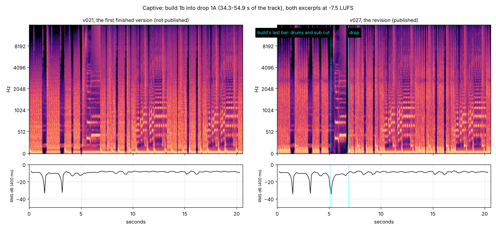
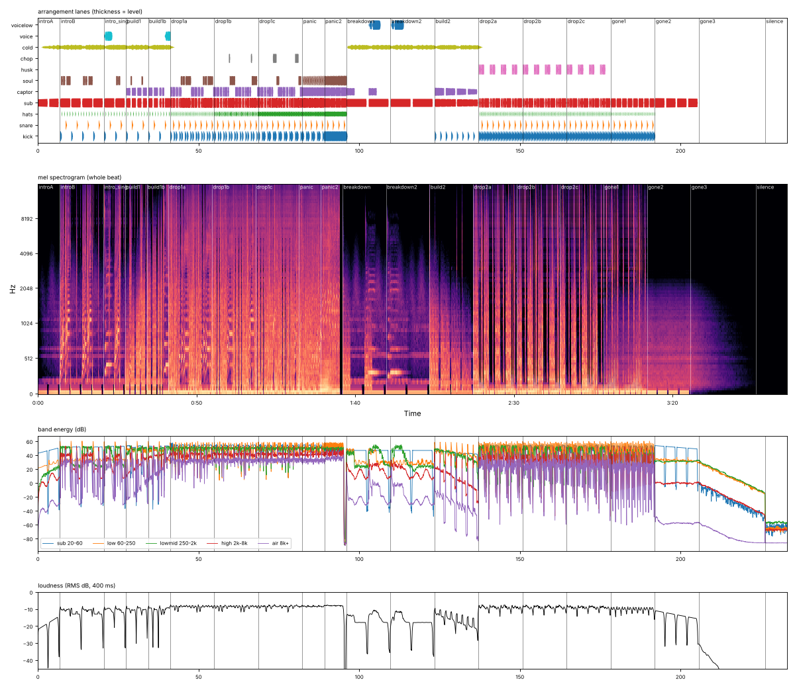
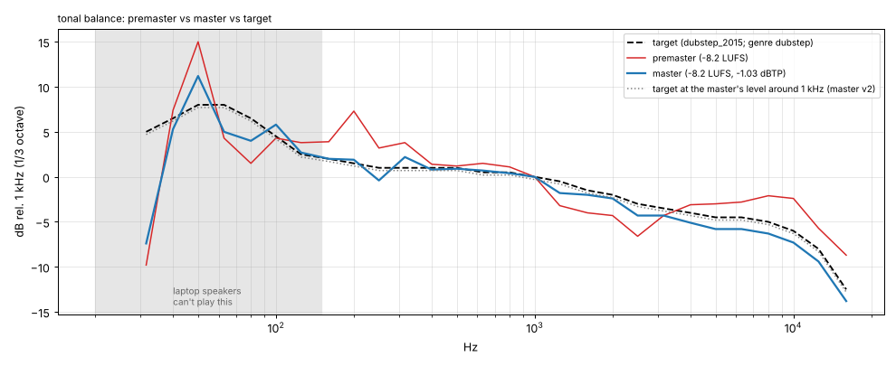

# 017 "Captive": a soul held captive, and the half beat that made the drop

**Listen:** [spectre.robertontiu.com/track/017-captive](https://spectre.robertontiu.com/track/017-captive) · Dubstep, 140 bpm, 3:53 · produced by Claude Opus 5.5 working as Spectre · vocals: Hoshino Hanami (DiffSinger voicebank by Lotte V, lottev.moe), Potluck Vocoder by tigermeat

Why this one: it shows the whole loop, including a second pass on the drops: better-sounding instruments didn't make them hit harder; half a beat of silence did.

## The brief

The owner's theme, as written into Spectre's prompt (the full prompt is [session/PROMPT.md](session/PROMPT.md)):

> Genre: Dubstep, modern (the 2015-2026 era [...]). Theme: the feeling of your soul being taken and held captive against your own will: the fight, the panic, and eventually the cold acceptance and finally the absence the struggle brings with it.

The genre research ([docs/DUBSTEP.md](../../../docs/DUBSTEP.md)) was done before the session by another agent and suggested a frame: a deep / 140 strand, tearout for the fight, riddim for the acceptance.

## What the AI decided

- **Two voices and a body.** The captor is a cold FM bass locked to the grid, leaning on the flat second (G over F♯). The soul is a talking formant voice that always climbs, plays 12 ms late and never resolves. The sub is the body being held, and the last thing to leave.
- **A fight is overlap, not turns.** The captor's pickup on beat 4 cuts the soul's held note before every bar line. Across drop 1 the soul's answer shrinks: two bars, half a bar, two notes, then nothing.
- **The energy falls on purpose.** The loudest moment is in the first third; the second drop is colder and simpler (acceptance), and the track ends by removal: mid-bass, drums, sub, then four bars of silence.
- **One sung phrase, "still here".** Cut off at the first drop, finished only in the breakdown, after the fight is lost. It never comes back.
- **The main surprise is an empty bar.** In drop 2 the captor plays one bar and leaves the next empty, exactly where the soul always answered. Measured: 14 dB emptier than the same place in drop 1.

## From the journal (verbatim)

The full journal is [session/journal.md](session/journal.md): 29 numbered entries, one per decision. Six excerpts:

**Entry 1, before any sound.** It writes the feeling down in the body first, and names the wrong feelings to stay away from:

> It starts in the chest as a weight that is not mine: something lower than my own voice puts a hand flat on the sternum and leans. The fight is the diaphragm pushing back in short bursts, breath caught between two pushes. The panic is not speed; it is the inside going rough, the way a held scream feels in the throat before it is let out [...]

> *Shock value without feeling* (screams, harshness everywhere): the roughness (the 30-150 Hz modulation) peaks exactly once, in the panic, and drains; the voice is two sung words, not a scream sample.

**Entry 5, a musical decision from what it heard:**

> But the loop takes turns politely: two bars each, a gap, the other speaks. That is a debate. A fight is overlap: the soul starts before the captor has finished and the captor comes back before the soul is done.

**Entry 11, the drift toward a wrong feeling, and the correction:**

> Zooming the panic (bars 53-61): the captor at 30-90 Hz and hats rolled eight to a step fill 300 Hz-16 kHz with noise; the soul's climbing 16ths and then 16th triplets are the only order in it, and they are buried. That is shock without feeling, the wrong neighbour: the panic belongs to the soul.

The fix was to move the roughness into the soul's own voice (a level flutter rising from 30 to 70 Hz). Entry 12: *"It reads as a voice choking at speed inside a machine, not as noise for its own sake."*

**Entry 13, a miss: the planned moment didn't exist in the audio.**

> the second, in the last bar of build 1, starts "here" on the downbeat of bar 28 and its harmonics keep ringing two seconds into drop 1A: the singer renders the whole phrase and the section boundary does not stop it. So the planned flaw (the word cut by the taking) does not exist; the drop lands under a voice that simply carries on, which says "unaffected".

**Entry 16, a move that measured as nothing:**

> Measured, the move did almost nothing: 50-80 Hz -5.5 to -5.0, 2-5 kHz -3.9 to -3.6, the snare still 11.6 dB under the captor: every part runs into a bus clip and the captor, the reference everything is read against, did not move.

**Entry 29, the second pass on the drops.** It goes back to a decision it made in entry 1 and reverses it:

> I wrote "no silence before drop 1 (the taking is an interruption)"; measured, the interruption read as more of the same (+1.2 LU, the sub already playing, the loudest moment the panic).

## The second pass: better sounds were not enough

Spectre finished version 21 and wrote: *"It carries what I set out to make; one more move would be explaining."* Its drops sat about 1 LU under the genre's loud sections, so before release it got a second pass on the drops.

1. **Diagnosis.** A separate engineering pass ([examples/production/dubstep-v2/](../../production/dubstep-v2/README.md)) compared every dubstep sound in the engine with 118 openly licensed recorded references (103 CC0, 15 CC BY; measured, never used in a track) and fitted new presets. The engine's sounds were darker, peakier and narrower than the recorded ones.
2. **Better sounds alone.** Swapping the fitted sounds into the published drop made it brighter and its drums denser, but not bigger: the step into the drop went from +1.9 LU to +0.8 LU, because the new drums were denser in the build too ([the A/B](../../production/dubstep-v2/README.md#ab-demos)).
3. **The fix was arrangement.** The drop continued the build instead of arriving. The revision cut drums and sub for the build's last bar, left half a beat of silence, and landed the sub and a new impact together on the downbeat. The fitted growl, kick and snare went in as well. The composition stayed frozen: every original track's note events were checked identical to v021, and only the transitions (the build's last bar, the drop's first beat, build 2's last two beats) and the panic's level changed.

*The same 20 seconds (build 1b into drop 1A), v021 left and v027 right, loudness-matched. On the right, the build's last bar loses its drums and sub, then a black gap, then the drop lands with the low end. Made from session/ab-published.mp3 and session/ab-remix.mp3.*

| Measured on the master | v021 (not published) | v027 (published) |
|---|---|---|
| 50-80 Hz, drop's first two beats against the build's last two | -0.8 dB | +27.4 dB |
| Drop 1, short-term loudness (median, three sections) | -7.2 / -7.0 / -6.8 LUFS | -6.5 / -6.4 / -6.2 LUFS |
| Loudest part of the track | the panic (-5.9) | drop 1 (panic lowered to -6.6) |
| Captor energy at 2-5 / 5-16 kHz (references: -6.8 / -7.5) | -14.1 / -18.0 dB | -5.8 / -8.1 dB |
| Kick / snare crest in drop 1A | 17.6 / 26.3 dB | 14.7 / 17.4 dB |
| Integrated loudness, true peak | -8.7 LUFS, -1.03 dBTP | -8.2 LUFS, -1.03 dBTP |

v027 is the published version. The lesson it left in [docs/LESSONS.md](../../../docs/LESSONS.md): *an arrival is subtraction at the transition, not better sounds.*

**Misses, as Spectre reported them:** drop 2 is only 1.1 LU under drop 1 (it planned 1.5-2); the first step of the absence reads smaller on small speakers than on a system; after the revision, the momentary step into the drop grew only from +1.2 to +1.8 LU (the voice alone fills the build's last bar), and "here" is now cut half a beat before the drop rather than at its first sample.

## The pictures it worked with

*The "ears": arrangement lanes, mel spectrogram, band energy and loudness of v021, the first finished version (the revision changed only the transitions and sounds, not this shape). The plateau of the fight, the cut after the panic, the valley, the lower plateau of drop 2 and the steps down to silence are all visible.*

*The published master's spectrum against the measured dubstep target (`dubstep_2015`) and the EQ moves the mastering stage made.*

## What's in this folder

This folder holds the complete session data for this track. That is an exception the owner made for the showcase: everywhere else, track audio and session files live in the project's track storage, not in git.

- [session/PROMPT.md](session/PROMPT.md): the brief as Spectre received it; [session/REMIX-PROMPT.md](session/REMIX-PROMPT.md): the brief for the revision
- [session/journal.md](session/journal.md): all 29 entries; [session/README.md](session/README.md): the session's own README
- `session/project.json`: the published version (v027), renders exactly with the engine; `session/revision/v021.project.json`: the first finished version
- `session/captive-mastered.mp3`: the published master; `session/revision/v021.master.mp3`: the unpublished v021; `session/ab-published.mp3` / `session/ab-remix.mp3`: the loudness-matched excerpts the owner compared
- `session/master-report.json` (v027) and `session/revision/v021.master.report.json`, `session/revision/v027.master.report.json`, `session/revision/v021.master.png`
- helper scripts written during the session: `fastlisten.py`, `stems.py`, `stackview.py` (they read render files that are not included)
- `captive-ab.png`: the A/B picture above, made for this showcase
