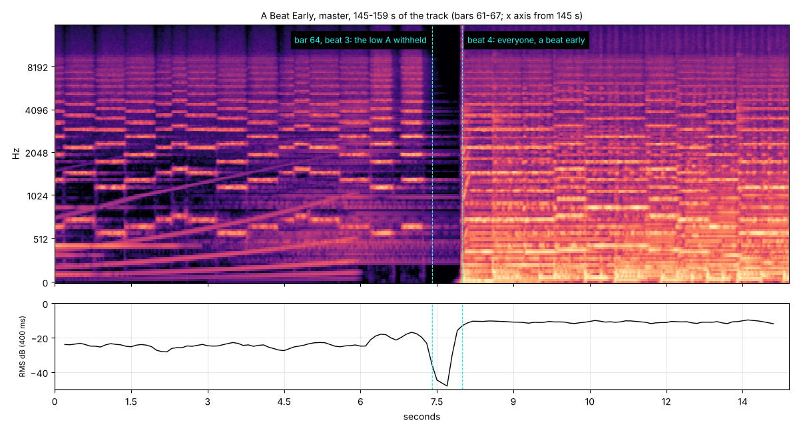
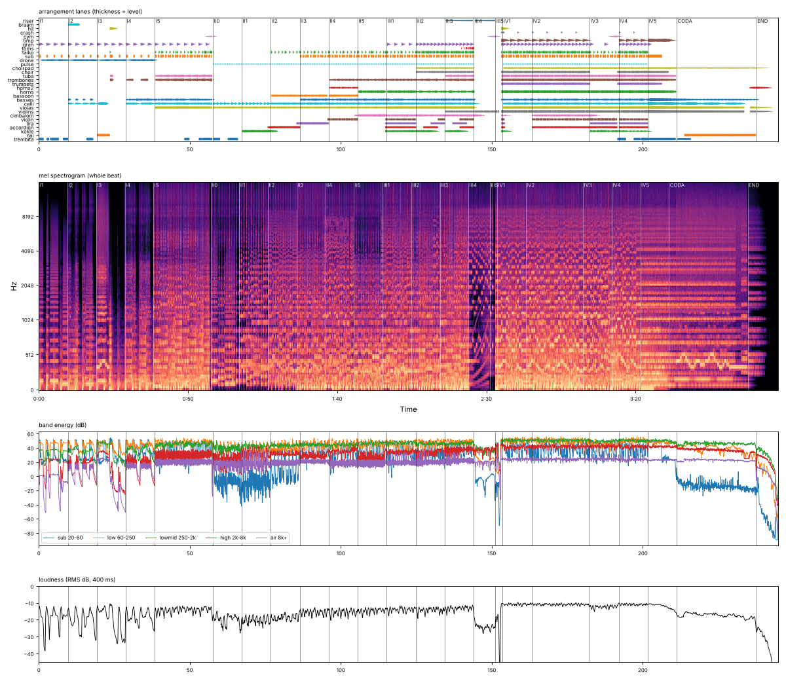
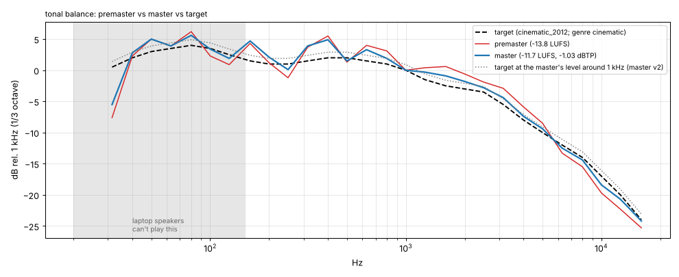

# 018 "A Beat Early": the Ode to Joy, built to earn one syncopation

**Listen:** [spectre.robertontiu.com/track/018-a-beat-early](https://spectre.robertontiu.com/track/018-a-beat-early) · Cinematic hybrid, 100 bpm, 4:08 · produced by Claude Opus 5.5 working as Spectre · no sung voice (a wordless choir from the engine's own synthesized voices)

Why this one: the whole track grows from one musical observation, and the journal shows the ears catching two things the producer would otherwise have shipped: a string motor that existed in the score but not in the audio, and a key change that was a surprise only on paper.

## The brief

The owner's theme, as written into Spectre's prompt (the full prompt is [session/PROMPT.md](session/PROMPT.md)):

> Genre: Cinematic hybrid / epic, modern [...]. Theme: united we stand, divided we fall: triumph, encouragement and overcoming struggles together, to lift the spirit of Europeans; "united in diversity": the Ode to Joy theme passed between the folk colours of several European traditions before the full ensemble takes it.

The genre research ([docs/CINEMATIC_HYBRID.md](../../../docs/CINEMATIC_HYBRID.md)) came first: strands, tempos, a four-act shape, the orchestra and trailer sounds the engine needed, and Beethoven's melody verified from the score (public domain; the copyrighted Karajan arrangement is never used).

## What the AI decided

- **One picture to start from:** "a room that lands on the note before it's due, as if it couldn't wait". Beethoven's tune already has that: its one syncopation, the F♯ that arrives on beat 4 instead of the downbeat. The whole track is built to earn that beat.
- **Divided, then united, in one tune.** The tune is first heard broken and in minor (a far nai, cut off before its fifth note), then passed in major from voice to voice: kokle, accordion, hurdy-gurdy, lăutar violin, cimbalom, one phrase each, each entering on the last note of the one before, over one ostinato that never stops. Then the five together, then everyone.
- **The arrival comes a beat early.** The lead-in thins to the violins alone; on bar 64 the low A on beat 3 is withheld (one dark beat), and everyone, trumpets and timpani for the first time, lands on the early F♯.
- **The key lift is harmony, not a gear change.** On the same anticipation, later, every part turns to F major on the common tone A, with the level held within 1 dB.
- **The cut-off voice gets the last word.** In the coda the nai plays the half of the tune it was denied in Act I, inside a chord the others hold for it.
- **No sung words**, by choice: the subject is political and the voicebank's licence forbids political use.

## From the journal (verbatim)

The full journal is [session/journal.md](session/journal.md): 26 numbered entries. Six excerpts:

**Entry 1, the feeling before any sound:**

> Then a moment where everyone breathes in together and the floor drops away for one beat, and the whole room lands on the note *before* you expected it, as if they couldn't wait. The triumph should feel like being lifted by people, not like being saluted: open throat, eyes stinging, standing a little taller.

**Entry 1, naming its own habits and breaking one:**

> **the climax lands a beat early**, on beat 4, on Beethoven's own anticipation: the silence is a single beat (where the low A should be) and everyone arrives on the early F♯, tied over the bar line. "As if they couldn't wait" is the subject: togetherness arriving before it's due.

**Entry 7, a miss found by measuring:**

> So the "one motor under the relay" I designed doesn't exist in the audio, and the triumph is a folk band in front of an orchestra.

(The violas' ostinato never reached -45 dB in Act II, and the folk soloists were the loudest things in the triumph. After the rebalance in v006 the violas sat at -31 dB and the celli at -29 under the relay, with the soloists inside the texture at -26 to -29.)

**Entry 10, its own mistake:**

> Worse, my own mistake: I placed the nai's final F a whole 4 bars late (a' is 64 steps, not 128), so the voice "finished" into an empty bar and then sounded its tonic out of nowhere.

**Entry 15, the surprise that was only on paper:**

> on beat 4 of bar 80 the horns, trumpets and choir move to F major, but the ostinato, the basses' and the sub's hits and the choir pad stay on A major to the end of the bar: an A1 and an F2 at once, A major smeared over F. The surprise was only on paper.

Entry 16, after every part was made to turn on that beat: *"That is the second surprise in the audio."*

**Entry 26, a conflict in the research, flagged instead of hidden:**

> the research's two numbers for this brief (-12.5 integrated *and* a climax near -7.5) can't both be met here; I followed the one the brief calls the measure ("the loudness is the climax's, the first half stays quiet") and mastered at `--lufs -11.5`

## Before and after

How the arrival grew across the renders (loudness of the lead-in against the arrival, from the journal):

| Render | Lead-in | Arrival | What changed |
|---|---|---|---|
| v004 | -11.6 LUFS | -12.0 | First full draft: Act III louder than the arrival; the withheld beat "reads as a hiccup, not a door" |
| v005 | -14.7 | +3.5 LU over the lead-in | Everything before the arrival shrunk |
| v006 | -13.8 | -9.9 | The orchestra rebalanced to carry: +4 LU |
| v007 | -18.8 | -9.8 | The lead-in reduced to the violins alone over the riser: +9 LU, the largest step in the track |
| v024 master | -23.8 dB RMS | -10.3 dB RMS | The withheld beat itself at -30.7 dB RMS: 20 dB under the arrival on beat 4 |

*The published master around the arrival: the thin, high lead-in with the riser's glides, two detached notes, the dark beat where the low A is withheld, then the whole spectrum lit on beat 4. Made from session/a-beat-early-mastered.mp3 for this showcase.*

The master: -11.7 LUFS integrated, -1.03 dBTP, climax -8.1 LUFS short-term, inside the measured middle half of trailer albums (-13.7 to -10.8).

**Misses, as Spectre reported them:** the struggle's peak is as loud as Act III, so the gathering doesn't climb far above it; Act III rises only about 1 LU across its three sections; the low mids stay crowded in the tutti; the folk soloists in the climax sit 5-8 dB under the orchestra and are felt more than heard.

## The pictures it worked with

*The "ears" on the final version: arrangement lanes, mel spectrogram, band energy and loudness. The spiky, broken first act, the relay climbing, the held breath and the arrival are all visible.*

*The master's spectrum against the measured cinematic target (`cinematic_2012`) and the EQ moves the mastering stage made.*

## What's in this folder

This folder holds the complete session data for this track. That is an exception the owner made for the showcase: everywhere else, track audio and session files live in the project's track storage, not in git.

- [session/PROMPT.md](session/PROMPT.md): the brief as Spectre received it
- [session/journal.md](session/journal.md): all 26 entries; [session/README.md](session/README.md): the session's own README
- `session/project.json`: the published version (v024), generated by `session/gen.py` (the verified phrases, harmony and sections) and rendered exactly by the engine
- `session/a-beat-early-mastered.mp3`: the published master
- `session/master-report.json`, `session/ear-overview.png`, `session/master-tonal-balance.png`
- `session/stems.py`: per-section stem levels (reads render files that are not included)
- `arrival.png`: the picture above, made for this showcase
